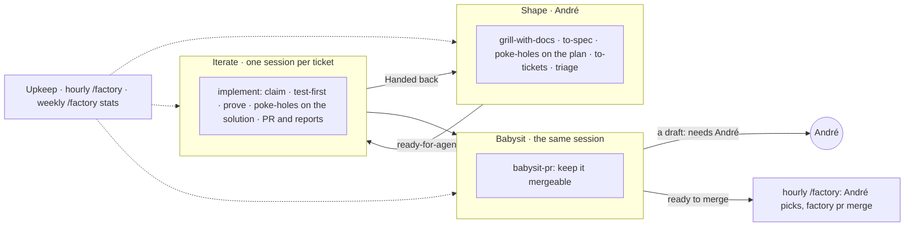
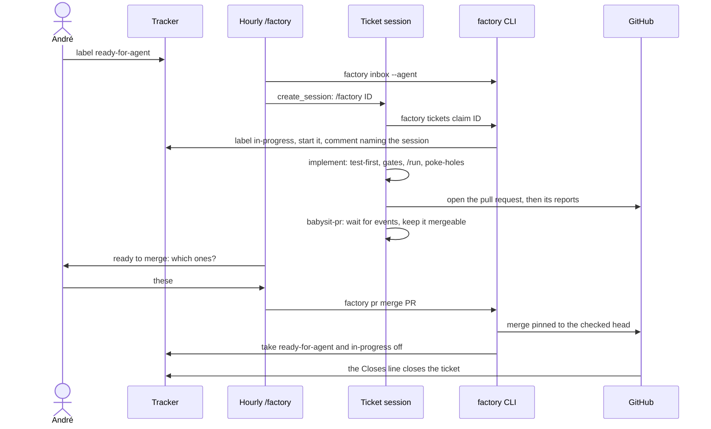

# Factory

The factory turns an approved ticket into a pull request ready to merge with
nobody watching, and stops where only André can move it. It runs the same on
the Mac and in Claude Code cloud sessions, and reads tickets from Linear or
GitHub Issues. [INSIGHTS.md](INSIGHTS.md) lists the ideas behind it and where
each came from. Evals for its skills live in
[andrezzoid/newsroom-evals](https://github.com/andrezzoid/newsroom-evals).

## Principles

1. Code exposes facts and state and enforces gates. Skills set goals, wire the
   process, and hold the rules and formats code can't. The model makes the
   judgment calls.
2. Anything that changes the contract goes on the ticket, anything that
   describes the work goes on the pull request, and review results stay in the
   session unless they need André.

## Phases

| Phase | Driven by | Skills | Produces |
|---|---|---|---|
| Shape | André, interviewed | grilling, grill-with-docs, to-spec, poke-holes, to-tickets, triage | tickets with acceptance criteria and blocking edges, labelled `ready-for-agent` |
| Iterate | a session per ticket | implement, tdd, codebase-design, code-review, complexity-red-flags, run, poke-holes, pr | a pull request whose acceptance runs as tests, and its reports |
| Babysit | the same session | babysit-pr | a mergeable pull request, or a draft that says what André must do |
| Upkeep | routines, or André | factory, retro, hillclimb, correct | dispatched sessions, merges André picked, the brief, the weekly stats |

A ticket's phase follows from its labels and its open pull requests, which
`factory tickets show` reads:

| Label | Phase | Set by | Means |
|---|---|---|---|
| none | Shape | | new: nobody has triaged it |
| `needs-triage` | Shape | triage | André evaluates it |
| `needs-info` | Shape | triage | waiting on the reporter |
| `ready-for-human` | Shape | triage, or `factory tickets handback` | only André can move it |
| `ready-for-agent` | Iterate | triage, to-tickets or André | an agent may build it |
| `ready-for-agent` and `in-progress` | Iterate, Babysit once a pull request is open | `factory tickets claim` | a session holds it, and a comment names that session |
| `wontfix` | done | triage | nobody will build it |

`factory pr merge` takes `ready-for-agent` and `in-progress` off, and the
`Closes` line in the pull request closes the ticket.

Shape is the only phase that changes what a ticket means. When Iterate finds
that acceptance cannot hold, it hands the ticket back, and André reshapes it.
When André agrees a change during a session, the session posts it as a
`Revised ·` report and goes on. Deploying and monitoring are not phases: one
deploy carries several merged tickets, so they belong to Upkeep, per repo, once
the repo has a recipe for them.

## Contracts and reports

Two kinds of document carry the work between sessions and André.

The **contract** says what to build: triage's latest agent brief, or the
ticket's body until one exists, plus every `Revised ·` report posted after it.
Its acceptance criteria follow one set of rules,
`to-spec/references/acceptance-criteria.md`, shared by `to-spec`, `to-tickets`
and `triage`. `implement` builds test-first with the acceptance lines as the
test list, and `poke-holes` checks that each line has a test that asserts it.
Agents never edit a contract; `factory tickets show` assembles it.

A **report** says what happened where the work met something the contract
didn't settle. Every report is one comment with a title `<Kind> · <subject>`,
then Expected, Happened, Why (the evidence), Affects and, when only André can
act, Needs you. The template lives in
[implement/references/report.md](../../dotfiles/.agents/skills/implement/references/report.md).

| Kind | Goes on | Posted with | When |
|---|---|---|---|
| `Handed back` | the ticket, or its open pull request | `factory tickets handback`, or `factory pr report` | the contract can't hold, only André can decide, or a check fails three times running |
| `Revised` | the ticket | `factory tickets revise` | André agreed a contract change in a session |
| `Deviation` | the pull request | `factory pr report` | the work departs from the contract and acceptance still holds |
| `Unverified` | the pull request | `factory pr report` | neither a test nor a run could prove a claim |

On a pull request, a hand-back or a report with Needs you turns the pull
request back into a draft, which `factory inbox` lists as André's. Marking it
ready for review hands it back to the agent. poke-holes' review table stays in
the session.

## A ticket's life

## Who decides what

| Decision | Owner | Mechanism |
|---|---|---|
| What to build | André | grilling, to-spec, to-tickets or triage, and his approval |
| Whether to start | André | the `ready-for-agent` label |
| Which ticket is next | CLI | `factory tickets next`, `factory inbox --agent` |
| Who works it | CLI | `factory tickets claim`: the `in-progress` label; it refuses a ticket another session holds, unless told `--take-over` |
| Whose ticket it is | André, or the colleague assigned | the assignee, which the factory fills only when empty |
| Whether it works | the session, then fresh agents | acceptance tests, the gates, `code-review`, `complexity-red-flags`, `/run`, poke-holes |
| Whether it can merge | CLI | `factory pr merge`: no conflicts, every check green, no changes requested, no open thread, not a draft, no handed-back ticket |
| Whether it merges | André | he picks from the hourly run's list |
| What needs André | CLI, then agent | `factory inbox --human`, written up by the hourly `/factory` |

## Learning

Three skills and one factory mode change the harness, or a repo's guards, from
what went wrong. They belong to Upkeep: André or a routine starts them.

| | Finds | Fixes |
|---|---|---|
| One session | `retro` (Matt Pocock's): candidates ranked by severity | `hillclimb`: an edit to a skill's instructions, kept only when it improves both the cases it was tuned on and held-out ones |
| The week | `/factory stats`: hand-backs, reports that needed André, reverts and review comments, grouped into mistakes that happened at least twice | `correct`, on the ones André picks: it makes a mistake impossible, trying architecture, then types, then a lint, then a test, and docs last |

Wording changes to a skill go to `hillclimb`, because only an eval shows that
wording changed what agents do. It replays past sessions from the prompt before
the mistake; fewer than two occurrences is not a failure mode yet. Skill
descriptions are measured with `bin/triggers` in newsroom-evals instead. Past
sessions exist only on the Mac, in `~/.claude/projects`, so `hillclimb` runs
there.

## Pieces

- **Skills** live once, in `dotfiles/.agents/skills`, and
  `dotfiles/.claude/skills` links to them, so Claude Code and every harness that
  reads `~/.agents` load the same files. Third-party skills are vendored and
  pinned, so they can be tuned and still diffed against upstream; `to-spec`,
  `to-tickets` and `triage` carry the factory's edits. Retired skills wait in
  `skills/deprecated/`, out of every harness's reach.
- **The `factory` CLI** is zero-dependency TypeScript run by Node 22.18+ type
  stripping, entered through `bin/factory`.
- **The factory mod.** The factory skill folder is also a Claude Code mod,
  loaded from `~/.claude/skills/factory` with nothing in `settings.json`. At
  session start it puts `bin/` on PATH, and in the cloud it re-runs
  `cloud-setup.sh`, which pulls the latest harness. On every tool call it denies
  a raw merge (`gh pr merge`, the merge API, the GitHub MCP merge tools) and a
  plain force push, inside subagents too.
- **The Agent skills block** in a repo's `CLAUDE.md` or `AGENTS.md`, written by
  `/factory setup`: the tracker, the labels and where the domain docs live. The
  CLI reads its `Tracker:` line.
- **The run skill**, `.claude/skills/run-<name>/`, recorded by Claude Code's
  built-in `/run-skill-generator`, which only André can start. Agents start the
  app through the built-in `/run`, which loads it.

## Trackers

Ticket policy works on one normalized ticket, and each tracker is an adapter
behind the same interface (`scripts/trackers/types.ts`).

| | Linear | GitHub Issues |
|---|---|---|
| Id | `ENG-123` | `owner/repo#12`, or `#12` inside a clone |
| Enabled by | `LINEAR_API_KEY`, or `linear auth login` on the Mac | `FACTORY_GITHUB_REPOS`, or a repo whose Agent skills block names GitHub Issues |
| Claimed | `in-progress`, and a started workflow state | `in-progress` |
| Blockers | "blocked by" relations | issue dependencies, or a `## Blocked by` section |
| Parent | children | sub-issues |
| Repo | `Repo: owner/name` line in triage's agent brief, else in the body | the issue's repository |
| A pull request closes it with | `Closes ENG-123` | `Closes #12` |
| Transport | GraphQL over fetch | `gh api` REST, since cloud sessions block GitHub GraphQL |

In a cloud environment on Pro or Max, the Linear key can be an API credential
the proxy adds to requests; `LINEAR_API_KEY=proxy-injected` tells the CLI to
send none of its own.

## Events

| Event | Cloud | Mac |
|---|---|---|
| A ticket is ready | the hourly `/factory` routine dispatches it | `factory tickets next --dispatch` in the clone |
| Activity on a pull request | `subscribe_pr_activity` wakes the session that owns it | Monitor on `factory pr watch` |
| A session goes quiet | the next hourly run lists its ticket and dispatches `/factory <ID> --take-over` | the same list, to start by hand |
| The week ends | the weekly `/factory stats` routine | `/factory stats` |

Neither Linear nor GitHub issue events can start a routine, so the hourly run
polls. `/factory setup` gives each routine's schedule and prompt.

## Known gaps

- Only a skill rule stops an agent from running `factory pr merge` itself: the
  mod blocks the raw merges, not the CLI's. The forge's branch protection is
  the wall.
- Two sessions that claim one ticket at the same moment can both win. That's
  accepted: one hourly routine does the dispatching.
- `factory inbox` takes three quiet hours to mean a session is gone, and an
  open thread counts against it only when someone other than an agent spoke
  last. A session that waits longer than that for CI looks gone too.
- A merged pull request whose `Closes` line missed its ticket leaves the ticket
  open with no labels, and the inbox then lists it as new.
- A cloud environment whose setup script does not run `cloud-setup.sh` gives
  its sessions no harness: no skills, no `factory` CLI, no mod.
- The cloud review-thread route (`ccr/review_threads`) returned an empty list
  in every probe, so its non-empty shape is a guess. The parser returns
  "unreadable" for a shape it does not know, which blocks the merge.
- The mod matches text, not intent: a merge from a script file or another
  language gets past it, and a commit message that quotes `gh pr merge` trips
  it.
- Whether routine sessions can call `create_session` is not documented.
- `claude --bg -w` dispatches locally only after the repo's workspace is
  trusted: run `claude` once interactively in each repo first.
- This version of the CLI (claims as a label, the inbox, stats, reports) has
  run only against its tests, not yet end to end on a real repo.
- The Linear queries are validated against Linear's schema and a mock server,
  and `test/linear.spec.ts` prices each one by Linear's published complexity
  rules, but they have never run against a real workspace.
